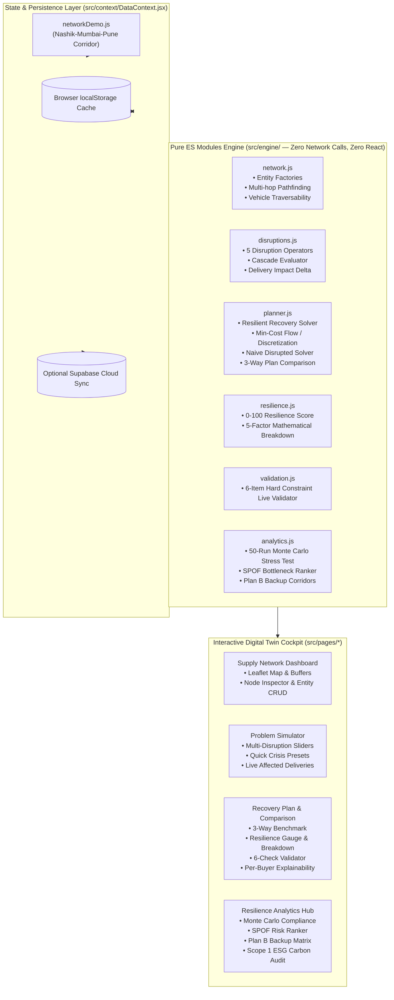

# Disruption-Aware Logistics Twin for Regional Supply Networks (Track 3-05)

> **Simulation • Optimization • Resilience • Explainability • Zero-Config Offline**  
> A lightweight, disruption-aware digital twin of a regional supply network (suppliers, warehouses, transporters, buyers) that simulates severe physical disruptions and recommends **resilient recovery decisions**—not just the shortest route.

[](https://github.com/arpitahyalij28-dot/nexasupply/actions/workflows/ci.yml)
[](LICENSE)
[](https://react.dev/)
[](https://vitejs.dev/)
[](https://tailwindcss.com/)
[](https://leafletjs.com/)
[](https://vitest.dev/)

Live Deployment: [https://logistics-twin.vercel.app/](https://logistics-twin.vercel.app/)

---

## 🏗 Architecture & System Design

The system is designed with strict mathematical separation of concerns:
1. **Pure ES Module Engine (`src/engine/*`)**: 100% deterministic, zero network calls, zero React imports. Runs in any browser or Node/Vitest test runner offline.
2. **Interactive UI (`src/pages/*`, `src/components/*`)**: React 18 + Vite + Tailwind CSS + Leaflet map. Visualizes live supply topologies, problem simulations, multi-plan comparisons, and explainability cards.
3. **Dual Persistence Layer (`src/data/repository.js`, `src/context/DataContext.jsx`)**: Automatically persists to browser `localStorage` in offline demo mode, with transparent fallback to multi-tenant Supabase PostgreSQL when credentials are provided.



---

## 📦 Regional Supply Network Data Model

The digital twin models a multi-tier regional supply network across the **Nashik & Western Maharashtra industrial-agro corridor**:

| Entity | Parameters | Role in Digital Twin |
|---|---|---|
| **Suppliers** (Tier 1) | `id`, `name`, `location` (lat/lng), `supplyLimit`, `product` | Upstream agro and industrial production hubs (Dindori Agro Park, Ambad MIDC, Sinnar SEZ). |
| **Warehouses** (Tier 2) | `id`, `name`, `location`, `stock`, `storageLimit` | Consolidation and buffer depots (Satpur MIDC, Igatpuri Mountain Gateway, Bhiwandi Super-Fulfillment Depot). |
| **Buyers** (Tier 3) | `id`, `name`, `location`, `demandQty`, `deadline` (hours), `priority` (`HIGH`, `MEDIUM`, `LOW`) | Downstream consumers (Thane Civil Hospital, Vashi APMC Mandi, Pune Auto Plant, JNPT Port). |
| **Corridor Routes** | `id`, `from`, `to`, `distanceKm`, `baseTravelTimeH`, `status` (`open`, `slow`, `closed`), `riskScore`, `restrictions` (`maxVehicleWeightTons`) | Highway connections (NH 160, Kasara Ghat, Murbad-Kalyan bypass, Mumbai-Pune Expressway). |
| **Vehicles** | `id`, `type`, `capacity` (units), `weightTons`, `costPerKm`, `speedKmH`, `availableFrom` (warehouseId), `availability` (trips) | Regional fleet (32ft Multi-Axle 15T, 20ft Container 8T, 14ft City Truck 3.5T, Pickup 1.5T). |
| **Scenario Settings** | `fuelPricePerLitre`, `rainfallMm`, `weights` (cost, time, lateness, unmet demand, risk, stock buffer) | Environmental and economic parameters influencing routing decisions. |

---

## 🧠 Resilient Recovery Solver Algorithm

### Why Custom Pure-JS Min-Cost Flow over External LP Libraries?
1. **Deterministic Zero-Dependency Execution**: Runs 100% offline in client browsers and Node/Vitest without WebAssembly loading latency, external solver binaries, or floating-point LP simplex cycle failures.
2. **Exact Discrete Integer Trips**: Enforces vehicle trip count $T = \lceil q / \text{capacity} \rceil$, avoiding fractional truck dispatches.
3. **Strict Non-Overlapping Resource Tracking**: Explicitly enforces that warehouse inventory and vehicle trip availability are never double-booked.
4. **Deterministic Explainability**: Generates human-auditable reasons for every dispatch decision.

### Mathematical Objective Function
The solver minimizes total generalized network impedance across all allocations $a \in \mathcal{A}$:
$$\min \sum_{a \in \mathcal{A}} \left[ w_{\text{cost}} \cdot C(a) + w_{\text{time}} \cdot T(a) + w_{\text{late}} \cdot \text{Late}(a) + w_{\text{risk}} \cdot R(a) \right] + \sum_{b \in \mathcal{B}} w_{\text{unmet}} \cdot P(b) \cdot U(b)$$

Where:
- $C(a) = \text{distance} \times \text{costPerKm} \times \frac{\text{fuelPrice}}{95.0}$
- $T(a) = \sum_{e \in \text{path}} \text{effectiveTravelTime}(e)$
- $\text{Late}(a) = \max(0, T(a) - b.\text{deadline})$
- $R(a) = \max_{e \in \text{path}} e.\text{riskScore}$
- $U(b)$ is the unmet demand quantity of buyer $b$, weighted by priority multiplier $P(b)$ ($3.5\times$ for Hospital/Mandi).

---

## 🛡️ Resilience Score Formula (0 - 100)

The resilience score quantifies network robustness under disruption with a transparent 5-factor mathematical breakdown:

$$\text{Resilience Score} = \underbrace{0.40 \times \text{OnTime}\%}_{\text{Max 40 pts}} + \underbrace{0.25 \times \text{Fulfillment}\%}_{\text{Max 25 pts}} + \underbrace{0.15 \times \text{CostStability}}_{\text{Max 15 pts}} + \underbrace{0.10 \times \text{RouteDiversity}}_{\text{Max 10 pts}} + \underbrace{0.10 \times \text{StockBuffer}}_{\text{Max 10 pts}}$$

- **On-Time Delivery (40 pts)**: Percentage of demanded units delivered before buyer deadlines.
- **Demand Fulfilled (25 pts)**: Total delivered units vs total demanded units (penalizing unfulfilled high-priority hospital cargo $3.5\times$).
- **Cost Stability (15 pts)**: Ratio of recovery plan cost vs nominal pre-disruption baseline plan.
- **Route Diversity & Backups (10 pts)**: Fraction of critical buyers with at least 2 open, non-severed corridor paths.
- **Stock Buffer Retention (10 pts)**: Ratio of warehouse reserve inventory remaining post-dispatch.

---

## ✅ Live 6-Item Dispatch Constraint Validator

Every dispatch plan (Baseline, Naive Disrupted, and Recovery) is audited in real-time by `validateDispatchPlan(plan, network)`:
1. **Warehouse Stock Limit**: Depot outbound shipments $\le$ available inventory.
2. **Warehouse Storage Capacity**: Total inventory $\le$ physical depot limit.
3. **Vehicle Capacity & Discrete Trips**: Shipped cargo $\le \text{capacity} \times \text{trips}$.
4. **Road Restrictions & Closures**: Zero closed routes traversed; vehicle weight limits strictly obeyed.
5. **No Double Resource Allocation**: No vehicle or inventory unit allocated multiple times.
6. **Buyer Demand Upper Bounds**: No buyer receives more than ordered quantity.

---

## ⚡ How to Run Offline (Zero Environment Variables)

The entire digital twin runs 100% client-side with zero configuration and zero external API dependencies:

### 1. Installation
```bash
git clone https://github.com/arpitahyalij28-dot/nexasupply.git
cd nexasupply
npm install
```

### 2. Run Locally
```bash
npm run dev
```
Open [http://localhost:5173](http://localhost:5173) in your browser. The application runs immediately in **Local Sandbox Mode** with zero `.env` setup.

### 3. Run Automated Tests
```bash
npm test
```
Executes all 21 test suites (125 tests) verifying pathfinding, disruptions, solver feasibility, resilience scores, and Monte Carlo stability.

---

## 🎬 2-Minute Demo Walk-Through: Kasara Mudslide & Recovery

Follow this step-by-step narrative to evaluate the digital twin:

### Step 1: Inspect the Baseline Supply Network
1. Navigate to **Supply Network** (`/`).
2. Verify the **DEMO DATA** badge is visible.
3. Observe the 3 consolidation depots (Satpur MIDC Nashik, Igatpuri, Bhiwandi) and 6 regional buyers (Thane Civil Hospital, Vashi APMC Mandi, etc.).
4. Click on **Satpur Depot** or **Thane Civil Hospital** to inspect buffer inventory, deadlines, and direct routes on the Leaflet map.

### Step 2: Inject Severe Mountain Corridor Disruption
1. Navigate to **Problem Simulator** (`/disruptions`).
2. In the preset cards, click **"Kasara Mudslide (Heavy Rain)"**.
3. Observe that:
   - Rainfall slider jumps to **85 mm** (exceeding the 75 mm landslide threshold).
   - NH 160 Kasara Ghat mountain artery turns **RED (Closed)**.
   - Secondary mountain pass turns **AMBER (Slow - 50% speed)**.
   - The **Affected Deliveries** panel immediately flags high-risk orders to Thane Civil Hospital and Vashi Mandi.
4. Click **"Apply Disruptions to Network"**. The **SIMULATED** badge activates across the platform.

### Step 3: Compare Baseline vs Naive vs Resilient Recovery
1. Navigate to **Recovery Plan** (`/assignments`).
2. Examine the **Three-Way Plan Comparison Table**:
   - **Baseline (Normal)**: 100% on-time, 92 Resilience Score.
   - **Disrupted (Naive Basic Strategy)**: Suffers severe unfulfilled orders, 0% on-time, Resilience Score drops to **24/100 (Critical Failure)**.
   - **Disrupted (Resilient Recovery Solver)**: Reroutes cargo around the closed Kasara Ghat via the southern Murbad-Kalyan bypass corridor, restores on-time delivery, and recovers Resilience Score to **76/100 (High Resilience)**.
3. Inspect the **Live Validator Checklist**: All 6 checks show **PASSED (Green)**.
4. Inspect the **"Why this plan?"** box on the Thane Civil Hospital card: Explains deterministic selection of Bhiwandi backup buffer and alternate bypass.

### Step 4: Run Monte Carlo Stress Test & SPOF Ranker
1. Navigate to **Resilience Analytics** (`/analytics`).
2. In the **Monte Carlo (50 Runs)** tab, review compliance rates across 50 randomized crisis scenarios (Mulberry32 seeded PRNG).
3. Switch to the **SPOF Ranker** tab: Inspect the ranked Single Points of Failure, noting that Kasara Ghat and Bhiwandi Hub are flagged as top structural bottlenecks.
4. Switch to the **Plan B Backups** tab: Verify pre-mapped bypass routes for all critical buyers.

---

## 👥 Multi-Contributor Git Workflow & Remote Sync

To protect concurrent contributions across team members, the repository includes an automated synchronization helper:

```powershell
# In PowerShell:
.\scripts\git-sync.ps1
```

Or standard git flow:
```bash
git fetch origin logistics-twin-features
git status
npm test
git add .
git commit -m "feat: description"
git push origin logistics-twin-features
```
