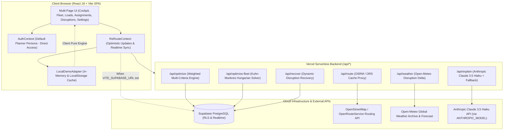

# Disruption-Aware Logistics Twin for Regional Supply Networks

> **Predictive • Proactive • Explainable • Resilient • Coordinated**  
> Enterprise-grade regional logistics twin platform designed for real-time corridor optimization, multi-criteria freight matching, combinatorial fleet assignment, and dynamic disruption recovery across regional commercial networks.

[](https://github.com/arpitahyalij28-dot/ReRouteAI/actions/workflows/ci.yml)
[](LICENSE)
[](https://react.dev/)
[](https://vitejs.dev/)
[](https://tailwindcss.com/)
[](https://supabase.com/)

Live Deployment: [https://reroute-fleet.vercel.app/](https://reroute-fleet.vercel.app/)

---

## 🏗 System Architecture

The Logistics Twin is built on a decoupled, resilient architecture supporting both zero-configuration offline demonstration and secure multi-tenant cloud operations:



---

## ⚡ Empty-First Dynamic Architecture & Data Modes

The platform operates with a client-first, empty-by-default architecture:
- **Clean Slate on Fresh Launch**: The application initializes with zero default records, enabling supply network planners to input their real-world vehicles and regional consignments immediately.
- **On-Demand Demo Loading**: At any time, operators can click **"Load Demo Data"** in the header or empty states. If data is already present, the system prompts whether to **Replace** or **Merge** with existing consignments.
- **Client Persistence**: All added trucks, shipments, assignments, and model overrides persist in browser `localStorage` across page reloads.
- **Instant Reset**: A single **"Clear All Data"** action (with confirmation safeguard) returns the platform to the initial clean state.

| Feature | Dynamic Client Mode (Default) | Cloud Sync Mode |
|---|---|---|
| **Initial App State** | Clean slate (empty vehicles & consignments) | Connects to Supabase Database |
| **Demo Data Injection** | On-demand via "Load Demo Data" button | Database migration seeds |
| **Data Entry** | Interactive modals (+ Add Truck, + Add Load) | Database CRUD / UI forms |
| **Storage Engine** | Browser `localStorage` + Memory | Multi-Tenant PostgreSQL (Supabase) |
| **Zero Env Vars Required** | ✅ Yes (100% offline & local ready) | Requires Supabase credentials |
| **User Access** | Single Planner persona (no login required) | Direct Dashboard access |
| **Algorithmic Evaluation** | Client pure ES Modules (`src/engine/`) | Serverless Endpoints (`/api/*`) + Fallback |
| **AI Explainability** | Deterministic rule-based template engine | Claude 3.5 Haiku + Fallback |

---

## 📥 How to Add Data & Use the Demonstration Mode

### 1. Adding a Vehicle (Truck)
1. Click **"+ Add Truck"** in the header navigation or the empty fleet prompt.
2. Enter the **Truck ID** (e.g. `T-202`), **Driver Name**, **Vehicle Type** (Open Body, Container, Trailer, Tanker), **Total Capacity**, **Current Load**, and select **Origin** and **Destination** cities from the regional hub directory (Nashik, Mumbai, Pune, Thane, Bhiwandi, Surat, etc.).
3. Choose status (*In-Transit*, *Available*, *Returning*).
4. Save the vehicle. The Corridor Map immediately plots the route, and the transit opportunity window begins live.

### 2. Adding a Shipment / Consignment Load
1. Click **"+ Add Load"** in the header navigation or the empty loads pool prompt.
2. Enter the **Consignment Name**, **Pickup City**, **Drop City**, **Cargo Weight**, **Pickup Window**, **Freight Rate (INR)**, and **Priority Level**.
3. Save the shipment. The weighted multi-criteria matching engine immediately computes compatibility scores (Alignment, Detour, Time, Capacity, Freight Yield) for all available trucks.

### 3. Loading Pre-Packaged Demo Data
- Click **"Load Demo Data"** in the header to load standard corridor scenario assets (including vehicle `T101` on the Nashik ↔ Mumbai NH 160 Kasara Ghat corridor, shipments `S1` through `S3`, and corridor waypoints).
- If you already have active data, select **"Replace"** to restore pristine demo state, or **"Merge"** to append demo loads to your existing fleet.

### 4. Clearing Data
- Click **"Clear All Data"** in the header to wipe all stored trucks, loads, and corridor assignments, returning the cockpit to its clean empty state.

---

## 🔍 Operational Transparency: Real vs. Heuristic Systems

Every sub-system in the Logistics Twin is categorized transparently:

1. **Vehicle Telemetry & Tracking**:
   - **Demo Mode**: Simulated GPS coordinates and speed progressions along the corridor (Nashik Ambad ↔ Bhiwandi via Kasara Ghat).
   - **Cloud Mode**: Telemetry state managed in PostgreSQL repository.
2. **Weather & Road Routing**:
   - **Real External APIs**: Live routing coordinates fetched from `/api/route` (OpenRouteService / OSRM API). If offline or rate-limited, gracefully falls back to Haversine with a 1.25x road winding tortuosity factor.
   - **Live Weather**: Weather metrics fetched from `/api/weather` (Open-Meteo API) evaluating actual precipitation, wind speed, and temperature disruption risk deltas along the corridor.
3. **Multi-Criteria Optimization & Scoring**:
   - **Deterministic Heuristic Algorithms**: Evaluates candidate matches using configurable Multi-Criteria Decision Analysis (MCDA) heuristics (Route Alignment 25%, Detour 15%, Time Window 20%, Capacity 20%, Freight Yield 10%, Disruption/Risk 10%). The weights are human-tunable heuristics rather than black-box learned neural weights, allowing full explainability and zero hallucinations.
4. **Fleet Optimization (Multi-Criteria Weighted Scoring + Global Assignment)**:
   - **Exact Combinatorial Mathematics**: True Kuhn-Munkres (Hungarian) algorithm running in $O(N^3)$ polynomial time, solving min-cost bipartite matching to maximize fleet-wide operational efficiency and minimize unassigned transit kilometers across any fleet size (1 to 50+ vehicles).
   - **Conflict Resolution**: When multiple trucks compete for the highest-yielding consignment, the global solver assigns the load to the highest overall compatibility score and tags competing trucks with explicit "Why Not?" justifications.
5. **AI Explainability Justification**:
   - **Dual-Engine Architecture**: Invokes Anthropic Claude 3.5 Haiku via `/api/explain` (configured via `ANTHROPIC_MODEL`, default `claude-3-5-haiku-20241022`) for natural language operator synthesis. When API keys are absent, instantaneously falls back to deterministic rule-based template summaries with verified mathematical trade-off proofs.

### 🌦️ Weather-Aware Scoring Engine
The platform integrates atmospheric intelligence directly into candidate evaluation without violating pure engine boundaries:
- **Zero-Engine Fetch Architecture**: The engine in `src/engine/*` remains 100% pure ES modules without any network fetch. `src/lib/weather.js` handles client-side caching (10-minute TTL, key rounded to 2 coordinate decimals) and in-flight request deduplication.
- **Engine Setting Propagation**: Atmospheric data is passed cleanly into `settings.weather` in `matching.js` and `eta.js`.
- **Quantitative Disruption Penalties**: Risk levels convert to penalties on the 6th multi-criteria component (Low Disruption Risk, clamped 5..100):
  - **Low Risk**: 0 penalty, standard transit conditions.
  - **Medium Risk**: -15 pts penalty, -10% operating speed slowdown.
  - **High Risk**: -35 pts penalty, -25% operating speed slowdown.
- **Deterministic Parity**: If weather data is absent or toggled off in Settings, matching scores and arrival predictions are 100% mathematically identical to nominal conditions.
- **Explainability & Verification**: Readable weather advisories (e.g. "Kasara Ghat violent showers: disruption score reduced (-35 pts), ETA +22 min") are attached to candidate explainability checklists, displayed on live maps and cards, and passed as non-PII metrics to `/api/explain`.
- **Simulation Sandbox**: A 1-click **Simulate heavy rain** toggle in the Disruptions page and DisruptionSimulator permits instant offline demonstration of high-risk storm mitigation.

---

## 📐 How the Algorithms & Math Work

### 1. Multi-Criteria Decision Analysis (MCDA) Compatibility Score

The compatibility score between vehicle $T$ and consignment $S$ is computed on a scale of $0$ to $100$:

$$\text{Score}(T, S) = \sum_{i=1}^{6} w_i \cdot f_i(T, S)$$

Where $\sum w_i = 100$:
- **Route Alignment ($w_1 = 25$)**: Penalizes deviations from the truck's destination hub.
- **Detour Tolerance ($w_2 = 15$)**: Computed using haversine detour distance over maximum driver tolerance.
- **Pickup Arrival Buffer ($w_3 = 20$)**: Evaluates predicted arrival against the shipper dock window.
- **Payload Capacity Fit ($w_4 = 20$)**: $100 \times \frac{\text{Weight}(S)}{\text{Capacity}(T)}$, penalizing under-utilization or vehicle type mismatch.
- **Economic Freight Gain ($w_5 = 10$)**: Normalized revenue contribution after incremental fuel costs.
- **Corridor & Weather Risk ($w_6 = 10$)**: Open-Meteo precipitation and wind penalties.

### 2. Autonomous Disruption Recovery (Under 400ms)

When a disruption event occurs (e.g., sudden shipper cancellation or severe storm warning):
1. **Event Interception**: The platform marks the affected assignment as `Cancelled` or `Delayed`.
2. **Immediate Re-Evaluation**: The engine scans all remaining unallocated loads.
3. **Promotion of Runner-Up**: The next highest-scoring feasible candidate is automatically recommended to the operator with a breakdown of why it was selected.

---

## 📁 Project Structure

```
├── api/                           # Vercel Serverless Functions
│   ├── _utils.js                  # Shared CORS, headers & error handling
│   ├── explain.js                 # Claude 3.5 Haiku natural language explanation
│   ├── geocode.js                 # Free regional geocoder with cache
│   ├── health.js                  # Liveness and readiness probe
│   ├── optimize-fleet.js          # Hungarian fleet assignment endpoint
│   ├── optimize.js                # Single-truck multi-criteria matching
│   ├── recover.js                 # Disruption re-allocation endpoint
│   ├── route.js                   # OSRM road geometry proxy
│   └── weather.js                 # Open-Meteo corridor weather endpoint
├── src/
│   ├── engine/                    # Pure, deterministic mathematical modules (0 external dependencies)
│   │   ├── distance.js            # Haversine distance & detour tortuosity
│   │   ├── eta.js                 # Speed, time windows, & weather delays
│   │   ├── risk.js                # Opportunity risk calculations
│   │   ├── matching.js            # Weighted Multi-Criteria Decision Analysis
│   │   ├── hungarian.js           # Exact Kuhn-Munkres O(N^3) assignment solver
│   │   ├── recovery.js            # Self-healing disruption recovery state machine
│   │   ├── sustainability.js      # Fuel and emissions metrics
│   │   └── validation.js          # Runtime constraint validation
│   ├── context/
│   │   ├── AuthContext.jsx        # Simplified default Planner persona
│   │   ├── DataContext.jsx        # Vehicle and load state persistence
│   │   └── ReRouteContext.jsx     # Optimistic state manager & Realtime listener
│   ├── data/
│   │   ├── mockData.js            # Comprehensive seed data (6 trucks, 15 loads)
│   │   └── repository.js          # LocalDemoAdapter & SupabaseAdapter
│   ├── pages/
│   │   ├── Dashboard.jsx          # Live Cockpit & corridor map
│   │   ├── Fleet.jsx              # Combinatorial Fleet Optimizer
│   │   ├── Loads.jsx              # Freight Demand Pool & Load Posting
│   │   ├── Assignments.jsx        # Committed fleet load tracking
│   │   ├── Disruptions.jsx        # Scenario simulator
│   │   ├── Settings.jsx           # Model weights & corridor coefficients
│   │   └── DataManagement.jsx     # Cloud sync & database status
│   └── components/                # Modular UI components
├── supabase/
│   ├── migrations/                # Idempotent PostgreSQL schema with RLS
│   └── seed.sql                   # Multi-tenant demonstration seed script
├── tests/
│   ├── demo-flow.test.js          # Automated smoke test suite
│   └── demo-flow.spec.js          # Playwright E2E browser specification
├── SETUP_MANUAL_STEPS.md          # Guide for Supabase & Vercel deployment
└── vercel.json                    # SPA routing rewrite configuration
```

---

## ⚠️ Limitations & Operational Boundaries

1. **OSRM Public Routing API**: The public OSRM demo server has community rate limits. In production, provide an `OPENROUTESERVICE_API_KEY` or self-host an OSRM instance. If the external routing service is unreachable or rate-limited, the system falls back seamlessly to Great-Circle Haversine distance with a corridor winding coefficient (1.25x).
2. **Hungarian Solver Scaling**: The Kuhn-Munkres algorithm runs in $O(N^3)$ computational complexity. For real-time browser interactions, batches are capped at 100 trucks $\times$ 100 loads. Larger fleets should be processed via asynchronous batch jobs or spatial corridor clustering.
3. **Weather Disruption Proxies**: Open-Meteo provides hourly precipitation and wind estimates. Localized flash road closures (e.g. landslides in the Kasara Ghat) require integration with highway authority FASTag/toll APIs.

---

## 📄 License
MIT License. Copyright © 2026 Logistics Twin Contributors.
