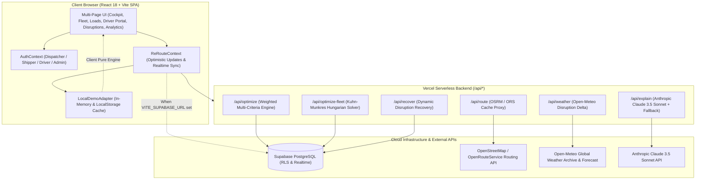

# ReRoute AI 2.0 — Predictive Backhaul Intelligence Platform

> **Predictive • Proactive • Explainable • Resilient • Sustainable**  
> Enterprise-grade autonomous backhaul intelligence platform designed to eliminate empty return miles (deadhead logistics) across high-density freight corridors.

[](https://github.com/arpitahyalij28-dot/ReRouteAI/actions/workflows/ci.yml)
[](LICENSE)
[](https://react.dev/)
[](https://vitejs.dev/)
[](https://tailwindcss.com/)
[](https://supabase.com/)

Live Deployment: [https://reroute-ai-2.vercel.app/](https://reroute-ai-2.vercel.app/)

---

## 🏗 System Architecture

ReRoute AI 2.0 is built on a decoupled, resilient architecture supporting both zero-configuration offline demonstration and secure multi-tenant cloud operations:



---

## ⚡ Empty-First Dynamic Architecture & Data Modes

ReRoute AI 2.0 operates with a client-first, empty-by-default architecture:
- **Clean Slate on Fresh Launch**: The application initializes with zero default records, enabling dispatchers and freight operators to input their real-world vehicles and backhaul loads immediately.
- **On-Demand Demo Loading**: At any time, operators can click **"Load Demo Data"** in the header or empty states. If data is already present, the system prompts whether to **Replace** or **Merge** with existing consignments.
- **Client Persistence**: All added trucks, shipments, assignments, and model overrides persist in browser `localStorage` across page reloads.
- **Instant Reset**: A single **"Clear All Data"** action (with confirmation safeguard) returns the platform to the initial empty state.

| Feature | Dynamic Client Mode (Default) | Cloud Sync Mode |
|---|---|---|
| **Initial App State** | Clean slate (empty trucks & loads) | Connects to Supabase Database |
| **Demo Data Injection** | On-demand via "Load Demo Data" button | Database migration seeds |
| **Data Entry** | Interactive modals (+ Add Truck, + Add Load) | Database CRUD / UI forms |
| **Storage Engine** | Browser `localStorage` + Memory | Multi-Tenant PostgreSQL (Supabase) |
| **Zero Env Vars Required** | ✅ Yes (100% offline & local ready) | Requires Supabase credentials |
| **Role Personas** | Switch instantly via UI header pill | Authenticated via Supabase Magic Links |
| **Algorithmic Evaluation** | Client pure ES Modules (`src/engine/`) | Serverless Endpoints (`/api/*`) + Fallback |
| **AI Explainability** | Deterministic rule-based template engine | Claude 3.5 Haiku + Fallback |

---

## 📥 How to Add Data & Use the Demonstration Mode

### 1. Adding a Vehicle (Truck)
1. Click **"+ Add Truck"** in the header navigation or the empty fleet prompt.
2. Enter the **Truck ID** (e.g. `T-202`), **Driver Name**, **Vehicle Type** (Open Body, Container, Trailer, Tanker), **Total Capacity**, **Current Load**, and select **Origin** and **Destination** cities from the Maharashtra hub directory (Nashik, Mumbai, Pune, Thane, Bhiwandi, Surat, etc.).
3. Choose status (*In-Transit*, *Available*, *Returning Empty*).
4. Save the vehicle. The Corridor Map immediately plots the route, and the deadhead risk countdown begins live.

### 2. Adding a Shipment / Consignment Load
1. Click **"+ Add Load"** in the header navigation or the empty loads pool prompt.
2. Enter the **Consignment Name**, **Pickup City**, **Drop City**, **Cargo Weight**, **Pickup Window**, **Freight Rate (INR)**, and **Priority Level**.
3. Save the shipment. The weighted multi-criteria matching engine immediately computes compatibility scores (Alignment, Detour, Time, Capacity, Freight Yield) for all available trucks.

### 3. Loading Pre-Packaged Demo Data
- Click **"Load Demo Data"** in the header to load standard corridor scenario assets (including vehicle `T101` on the Nashik ↔ Mumbai NH 160 Kasara Ghat corridor, shipments `S1` through `S3`, and corridor waypoints).
- If you already have active data, select **"Replace"** to restore pristine demo state, or **"Merge"** to append demo loads to your existing fleet.

### 4. Clearing Data
- Click **"Clear All Data"** in the header to wipe all stored trucks, loads, and corridor assignments, returning the cockpit to its clean empty state.

---

## 🔍 Operational Transparency: Real vs. Heuristic Systems

In line with enterprise evaluation best practices, every sub-system in ReRoute AI 2.0 is categorized transparently:

1. **Vehicle Telemetry & Tracking**:
   - **Demo Mode**: Simulated GPS coordinates and speed progressions along the NH 160 corridor (Nashik Ambad ↔ Bhiwandi via Kasara Ghat).
   - **Cloud Mode**: Real-time telemetry ingestion into PostgreSQL `telemetry_points` table via Driver Portal or hardware telematics webhooks.
2. **Weather & Road Routing**:
   - **Real External APIs**: Live routing coordinates fetched from `/api/route` (OpenRouteService / OSRM API). If offline or rate-limited, gracefully falls back to Haversine with a 1.25x road winding tortuosity factor.
   - **Live Weather**: Weather metrics fetched from `/api/weather` (Open-Meteo API) evaluating actual precipitation, wind speed, and temperature disruption risk deltas along the corridor.
3. **Multi-Criteria Optimization & Scoring**:
   - **Deterministic Heuristic Algorithms**: Evaluates candidate matches using configurable Multi-Criteria Decision Analysis (MCDA) heuristics (Route Alignment 25%, Detour 15%, Time Window 20%, Capacity 20%, Freight Yield 20%). The weights are human-tunable heuristics rather than black-box learned neural weights, allowing full explainability and zero hallucinations.
4. **Fleet Optimization**:
   - **Exact Combinatorial Mathematics**: True Kuhn-Munkres (Hungarian) algorithm running in $O(N^3)$ polynomial time, solving min-cost bipartite matching to maximize fleet-wide profitability and minimize deadhead kilometers.
5. **AI Explainability Justification**:
   - **Dual-Engine Architecture**: Invokes Anthropic Claude 3.5 Haiku via `/api/explain` for natural language operator synthesis. When API keys are absent, instantaneously falls back to deterministic rule-based template summaries with verified mathematical trade-off proofs.

---

## 📐 How the Algorithms & Math Work

### 1. Single-Truck Ranking: Weighted Multi-Criteria Scoring (MCDA)
For a given truck $T$ and candidate backhaul shipment $L$, the engine first validates four strict feasibility constraints:
1. **Status Feasibility**: $L.\text{status} \in \{\text{'Available'}, \text{'New'}\} \land \neg L.\text{isCancelled}$
2. **Payload Capacity Constraint**: $L.\text{cargoWeight} \le T.\text{availableCapacity}$
3. **Vehicle Compatibility**: $L.\text{requiredVehicleType} \in \{\text{'Any'}, T.\text{vehicleType}\}$
4. **SLA Window Feasibility**: $T.\text{predictedEta} \le L.\text{pickupWindowEnd}$

If feasible, the overall match score $S(T, L) \in [0, 100]$ is computed as:
$$S(T, L) = \frac{\sum_{i=1}^k w_i \cdot f_i(T, L)}{\sum_{i=1}^k w_i}$$

Where the 5 default factors are:
- **Route Alignment ($f_{\text{route}}$, 25%)**: Vector dot product and deadhead distance penalty from current return leg.
- **Time Compatibility ($f_{\text{time}}$, 20%)**: Margin between predicted vehicle ETA and shipper tender cutoff.
- **Payload Capacity Fit ($f_{\text{capacity}}$, 20%)**: Cargo mass utilization ratio relative to gross vehicle weight rating.
- **Detour Efficiency ($f_{\text{detour}}$, 15%)**: Linear penalty on additional kilometers diverted from nominal corridor.
- **Freight Cost Yield ($f_{\text{cost}}$, 20%)**: Net operational margin remaining after deducting detour diesel expenses.

### 2. Fleet Optimization: Kuhn-Munkres (Hungarian) Assignment
When allocating multiple trucks $T_1, \dots, T_n$ to multiple candidate loads $L_1, \dots, L_m$, greedy matching yields suboptimal fleet-wide deadhead miles. ReRoute AI uses an exact $O(N^3)$ implementation of the **Hungarian (Kuhn-Munkres) Combinatorial Solver** (`src/engine/hungarian.js`):
$$\min \sum_{i=1}^n \sum_{j=1}^m C_{ij} \cdot X_{ij} \quad \text{s.t.} \quad \sum_{j} X_{ij} \le 1, \; \sum_{i} X_{ij} \le 1$$
Where the assignment cost matrix is $C_{ij} = 100 - S(T_i, L_j)$ for feasible pairings and $\infty$ for infeasible pairings.

### 3. Self-Healing Disruption Recovery
When a committed tender is cancelled or delayed:
1. The system flags the affected assignment and releases highway reservations.
2. The remaining available corridor demand is filtered and scored in real-time.
3. Solver latency is measured via `performance.now()` (typically $<30\text{ms}$).
4. An explainable decision audit log records the root cause and promoted alternate load.

---

## 👥 Role-Based Portals

- **Dispatcher Cockpit (`/`)**: Full corridor visualization, real-time vehicle radar, empty-return risk countdown, and manual dispatch overrides.
- **Fleet Optimizer (`/fleet`)**: Multi-truck combinatorial assignment matrix solved globally via Hungarian algorithm.
- **Loads Pool (`/loads`)**: Freight demand catalog with search, filtering, and validated load posting.
- **Shipper Portal**: Shippers can post consignments and cancel their tenders directly with multi-tenant data isolation.
- **Driver Mobile Experience (`/driver`)**: Mobile-first portal showing assigned cargo, turn-by-turn Google Maps link, milestone check-ins (*Arrived at Pickup*, *Cargo Loaded*, *Delivered*), and a 10s background GPS telemetry transmitter.

---

## 🚀 Quickstart & Local Development

### Prerequisites
- Node.js 18.x or 20.x+
- npm or yarn

### Installation
```bash
# Clone the repository
git clone https://github.com/arpitahyalij28-dot/ReRouteAI.git
cd ReRouteAI

# Install dependencies
npm install

# Start development server (Offline Demo Mode, 0 env vars required)
npm run dev
```
Open [http://localhost:3000](http://localhost:3000) to view the cockpit.

> [!TIP]
> **Serverless Backend Simulation**: `npm run dev` runs the Vite frontend with automatic, graceful fallback to client-side pure mathematical solvers whenever `/api/*` is unreachable. To run the full-stack serverless functions locally alongside the frontend, run `npx vercel dev`.

### Run Quality & Test Suite
```bash
# Run Vitest unit & E2E smoke tests (35 tests)
npm test

# Run production build and verify bundle chunk sizes
npm run build
```

---

## 📦 Project Structure

```
ReRouteAI/
├── .github/workflows/ci.yml       # Automated GitHub Actions test & build workflow
├── api/                           # Vercel Serverless Functions
│   ├── _utils.js                  # CORS headers & in-memory rate limiting
│   ├── health.js                  # Health check & system status
│   ├── optimize.js                # Single truck MCDA ranking endpoint
│   ├── optimize-fleet.js          # Kuhn-Munkres combinatorial fleet matching
│   ├── recover.js                 # Disruption recovery endpoint
│   ├── route.js                   # OSRM / OpenRouteService caching proxy
│   ├── weather.js                 # Open-Meteo weather disruption risk proxy
│   └── explain.js                 # Claude 3.5 Sonnet explainability with fallback
├── src/
│   ├── engine/                    # Pure ES Module Mathematical Core
│   │   ├── distance.js            # Haversine distance & detour calculations
│   │   ├── eta.js                 # Velocity profiles & pickup window buffers
│   │   ├── risk.js                # Empty return probability calculations
│   │   ├── matching.js            # Weighted Multi-Criteria Decision Analysis
│   │   ├── hungarian.js           # Exact Kuhn-Munkres O(N^3) assignment solver
│   │   ├── recovery.js            # Self-healing disruption recovery state machine
│   │   ├── sustainability.js      # Diesel liters, CO2 kg, & cost savings
│   │   └── validation.js          # Zod-style runtime constraint validation
│   ├── context/
│   │   ├── AuthContext.jsx        # Supabase Auth & Demo Role Switcher
│   │   └── ReRouteContext.jsx     # Optimistic state manager & Realtime listener
│   ├── data/
│   │   ├── mockData.js            # Comprehensive seed data (6 trucks, 15 loads)
│   │   └── repository.js          # LocalDemoAdapter & SupabaseAdapter
│   ├── pages/
│   │   ├── Dashboard.jsx          # Live Cockpit & corridor map
│   │   ├── Fleet.jsx              # Combinatorial Fleet Optimizer
│   │   ├── Loads.jsx              # Freight Demand Pool & Load Posting
│   │   ├── DriverPortal.jsx       # Mobile-first driver dispatch view
│   │   ├── Assignments.jsx        # Committed load tracking
│   │   ├── Disruptions.jsx        # Scenario simulator
│   │   ├── Analytics.jsx          # ESG Scope 1 metrics & reports
│   │   ├── Settings.jsx           # Model weights & corridor coefficients
│   │   ├── DataManagement.jsx     # Cloud sync & database status
│   │   └── Login.jsx              # Magic link auth & demo access
│   └── components/                # Modular UI components
├── supabase/
│   ├── migrations/                # Idempotent PostgreSQL schema with RLS
│   └── seed.sql                   # Multi-tenant demonstration seed script
├── tests/
│   ├── demo-flow.test.js          # 7-stage automated smoke test
│   └── demo-flow.spec.js          # Playwright E2E browser specification
├── SETUP_MANUAL_STEPS.md          # Guide for Supabase & Vercel deployment
└── vercel.json                    # SPA routing rewrite configuration
```

---

## ⚠️ Limitations & Operational Boundaries

1. **OSRM Public Routing API**: The public OSRM demo server has community rate limits. In production, provide an `OPENROUTESERVICE_API_KEY` or self-host an OSRM instance. If the external routing service is unreachable or rate-limited, the system falls back seamlessly to Great-Circle Haversine distance with a corridor winding coefficient (1.25x).
2. **Hungarian Solver Scaling**: The Kuhn-Munkres algorithm runs in $O(N^3)$ computational complexity. For real-time browser interactions, batches are capped at 100 trucks $\times$ 100 loads. Larger fleets should be processed via asynchronous batch jobs or spatial corridor clustering.
3. **Weather Disruption Proxies**: Open-Meteo provides hourly precipitation and wind estimates. Localized flash road closures (e.g. landslides in the Kasara Ghat) require integration with highway authority FASTag/toll APIs.
4. **Driver GPS in Demo Mode**: In offline demo mode, driver GPS coordinates simulate transit along predefined waypoints between Nashik and Bhiwandi at 10-second intervals.

---

## 📄 License
MIT License. Copyright © 2026 ReRoute AI Contributors.
